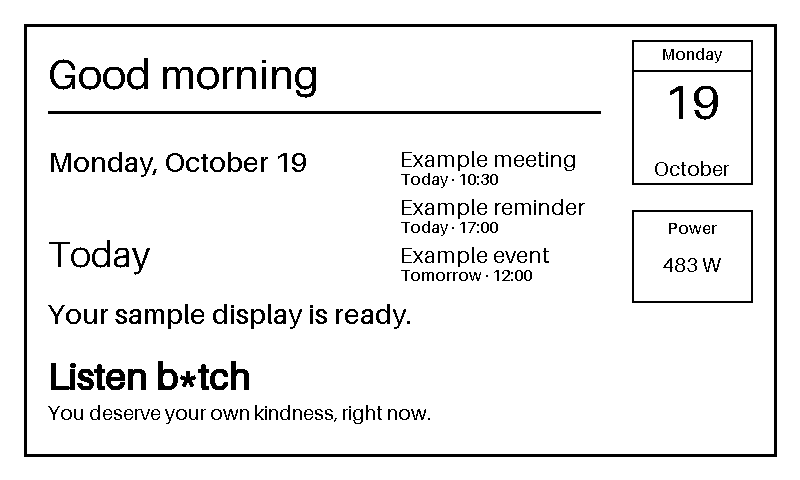

# Server

The server combines data providers with an editable layout, renders an 800×480
1-bit monochrome frame, and serves it to the ESP32. The browser preview shows
the same frame that the device receives. The version 1 byte format is described
in the [image contract](../docs/architecture.md#image-contract). For the
end-to-end setup sequence, see [setup and commissioning](../docs/getting-started.md).

## Run locally

```sh
cd server
python3 -m venv .venv
. .venv/bin/activate
python -m pip install -r requirements.txt
export SLATE_DEVICE_TOKEN="$(openssl rand -hex 32)"
export SLATE_REQUIRE_HTTPS=false
python3 app.py
```

Open <http://127.0.0.1:8000/preview> to see the sample layout. The raw frame is
available at <http://127.0.0.1:8000/api/frame/v1>. The endpoint requires
`Authorization: Bearer <device-token>`. The preview asks for the token in a
password field and keeps it in browser memory only. The token is never accepted
in a URL or written to server logs.

## Edit the layout

[`layout.json`](layout.json) controls the sample screen. It contains a fixed
800×480 canvas and an ordered `blocks` list. Blocks are drawn in list order on a
white background; positions are pixel coordinates from the top-left corner.
Black is used for text and shapes.

The layout supports these block types:

| Type | Required fields | Optional fields | Effect |
| --- | --- | --- | --- |
| `text` | `key` | `x`, `y`, `size` | Draw the provider value named by `key`. Defaults: position `(0, 0)`, size `24`. |
| `line` | `x2`, `y2` | `x`, `y`, `width` | Draw from `(x, y)` to `(x2, y2)`. Defaults: start `(0, 0)`, width `2`. |
| `rectangle` | `width`, `height` | `x`, `y`, `stroke` | Draw an outline from `(x, y)` to `(x + width, y + height)`. Defaults: position `(0, 0)`, stroke `2`. |
| `calendar` | — | `x`, `y`, `width`, `height`, `stroke`, `weekday_size`, `day_size`, `month_size`, `weekday_key`, `day_key`, `month_key` | Draw a calendar icon using the `weekday`, `day`, and `month` provider values. Defaults: position `(0, 0)`, size `120×140`, keys `weekday`/`day`/`month`, font sizes `16`/`48`/`20`. |
| `events` | — | `key`, `x`, `y`, `count`, `row_height`, `title_size`, `detail_size`, `max_width` | Draw event titles, dates, and times from a provider list. Defaults: key `events`, count `6`, row height `48`; optional `max_width` clips text with `...` at that many pixels. |

For example, this block displays the value for `greeting` at pixel `(48, 48)` in
a 42-pixel font:

```json
{"type": "text", "key": "greeting", "x": 48, "y": 48, "size": 42}
```

Change a block's `x` and `y` to move it, `size` to resize text, or the shape
fields to adjust lines and rectangles. The JSON canvas must remain 800×480 to
match the display and frame contract. The server notices changes to the layout
file and renders an updated frame on the next request; the open preview polls
every five seconds and redraws when the frame changes. When running with
Docker Compose, edit the host copy of `server/layout.json`.



## Providers and layout keys

A provider supplies the values used by text blocks. The interface is the
`Provider` protocol in [`providers.py`](providers.py): implement
`get_data()` and return a dictionary whose keys are names used by the layout.
Text values are strings; an event list contains title, date, and time fields.
For example:

```python
class SampleProvider:
    def get_data(self) -> dict[str, object]:
        return {
            "greeting": "Good morning",
            "date": "Saturday, October 17",
            "events": [{"title": "Coffee", "date": "Today", "time": "10:30"}],
        }
```

The layout's `"key": "greeting"` looks up the `greeting` entry and draws its
value, `Good morning`, in the image. The sample provider also returns
`headline` and `message`, which are used by the other text blocks in
`layout.json`. A text block with a key missing from the provider data is an
error, so keep the layout keys and provider keys in sync.

The server also adds values from `CurrentDateProvider`: `date`, `weekday`,
`day`, and `month`. The date format defaults to `%A, %B %d`; set
`SLATE_DATE_FORMAT` to a Python `strftime` format string to change it. The
weekday and month names use the server process locale. Set `TZ` to an IANA
timezone to control which local date is displayed. The calendar block can be
removed from the layout or positioned and sized independently of the formatted
date text.

To add another data source, create a provider with the same `get_data()`
interface, then wire it into the server in `app.py` in place of
`SampleProvider`. Keep each integration independent of rendering and keep its
credentials in local or deployment configuration, never in source control.
Editing provider code requires restarting the server; editing only
`layout.json` does not.

## Provider guides

Provider-specific setup and behavior is documented in the
[provider guides](../docs/providers/README.md). The sample provider is the
default. The current date provider is always added to provider data. To display
a Google Calendar, follow the
[iCal feed guide](../docs/providers/google-calendar-ical.md).

## Frame refresh and conditional requests

The server caches a rendered frame for `SLATE_REFRESH_SECONDS` (default 60),
then renders it again on the next request. Frame responses include a strong
SHA-256 ETag. Send it as `If-None-Match` to receive `304 Not Modified` while
the frame is unchanged:

```sh
curl -D headers.txt -o frame.bin \
  -H "Authorization: Bearer $SLATE_DEVICE_TOKEN" \
  http://127.0.0.1:8000/api/frame/v1
etag=$(awk 'tolower($1) == "etag:" { print $2 }' headers.txt)
curl -i -H "Authorization: Bearer $SLATE_DEVICE_TOKEN" \
  -H "If-None-Match: $etag" http://127.0.0.1:8000/api/frame/v1
```

The ETag is the quoted hexadecimal SHA-256 digest of the 48,000 frame bytes.
When the frame changes, the server returns `200 OK`, a new ETag, and the full
frame. A request after the render interval expires can trigger rendering before
the server compares ETags.

## Docker Compose

From the repository root, start the service with:

```sh
cp .env.example .env
openssl rand -hex 32
# Set SLATE_DEVICE_TOKEN in .env to the generated value.
docker compose -f compose.yaml -f compose.dev.yaml up --build
```

Open <http://127.0.0.1:8000/preview>. Compose reads `SLATE_PORT`,
`SLATE_REFRESH_SECONDS`, `SLATE_DATE_FORMAT`, `TZ`, `SLATE_DEVICE_TOKEN`, and
`SLATE_REQUIRE_HTTPS` from `.env`. The sample sets HTTPS enforcement off for a
private local demo; keep it on in production. It mounts
`server/` read-only so layout edits stay on the host; the container can read
but cannot change the layout. Mounting the whole directory also keeps atomic
file saves visible inside the container, unlike mounting only `layout.json`.
The server checks `layout.json` on each frame request, and the preview polls
every five seconds. The sample layout and provider contain no
household-specific data.

### Production deployment

The included Compose files support local development. A deployment that serves
a physical device must expose an HTTPS endpoint, keep the application port
behind its trusted network boundary, and configure the ESP32 to validate the
endpoint certificate. If `SLATE_REQUIRE_HTTPS=true`, the TLS proxy must send a
correct forwarded scheme value, and the application must only trust that value
from the controlled proxy network. Configure proxy routing, secret storage, and
network exposure in the deployment environment's private operations guide.
Never disable ESP32 certificate validation for a deployed device.

This is intended to be a public repository; follow the [public repository
hygiene notes](../docs/architecture.md#public-repository-hygiene). Secrets
belong in deployment configuration outside source control.
